<p align="center">
  <picture>
    <source media="(prefers-color-scheme: dark)" srcset="assets/logo-white.svg">
    
  </picture>
</p>

> [!NOTE]
> If you are interested in testing this and giving feedback, contributing, or just using it, you are welcome, and we hope it helps you. However, if you consider yourself the "ultimate genius" and criticize without trying it first, we are sorry: this project will not benefit you or from you.

# K-Veritas Go

<picture>
  <source media="(prefers-color-scheme: dark)" srcset="assets/demo-dark.svg">
  
</picture>

Cryptographic verification for computational experiments. Binds a result to the code, hardware and time that produced it, in a signed PDF anyone can verify. Any language, one static binary.

**Proves:** these numbers came from this code, at this time, unchanged. Not that the experiment is correct.

**Faking it:** every run is recorded, failed ones too, so an attempt shows.

Official implementation of [Computer Science Conferences Should Require Nonrepudiable Experimental Results](https://arxiv.org/abs/2605.08586) (Keita and Homan, NeurIPS 2026 Position Paper Track).

Linux, macOS, Windows. Activity map: Linux only.

## Install

```bash
# uv or pip (binary only)
uv tool install kveritas --find-links https://27-group.github.io/kveritas-releases/wheels/

# Prebuilt binary (also darwin/windows, amd64/arm64)
curl -fsSL https://github.com/27-GROUP/kveritas-releases/raw/main/bin/kveritas-linux-amd64 -o kveritas
chmod +x kveritas && sudo mv kveritas /usr/local/bin/

# Or build from source (Go 1.22+)
make build
```

## Quick start

```bash
kveritas run --seal -- python train.py   # run, sign, write report.pdf
kveritas python train.py                 # short for kveritas run -- python train.py
kveritas shell                           # recorded terminal: every command is a run
kveritas seal -o report.pdf              # sign after several runs
kveritas verify report.pdf               # --offline skips the server
```

## Result lines

Print them from any language.

```python
print(f"KV val_acc={acc:.4f} loss={loss:.4f} step={epoch}")
```

| Line | Purpose |
|---|---|
| `KV <name>=<number> ... [step=<label>]` | Metrics. |
| `KV phase <name>` | Phase boundary (hardware snapshot). |
| `KV claim <name>=<number> [phase=<name>]` | A headline claim. |
| `KV seed <value>` | A random seed. |
| `KV model params=<int> arch=<name> precision=<fp16\|bf16\|fp32>` | Model card. |
| `KV workload dataset_size=<int> epochs=<float> batch_size=<int> [seq_len=<int>]` | Workload card. |
| `KV artifact role=model\|dataset [name=<ref>] path=<file> visibility=public\|private` | Model or dataset. |

Strict: `KV cache: 2 GB` is ignored. Old `KVERITAS_*` lines still work.

**Measured** on every run: time, CPU, memory, GPU, energy.

**Autolog** (opt-in, `kveritas autolog on`): Hugging Face, Keras, Lightning, XGBoost, LightGBM, hyperfine, Google Benchmark, criterion, `time`, TensorBoard, MLflow, CSV logs. Marked `auto:<format>`.

**Headline results:** `kveritas seal --claim val_acc`.

## Features

- **Coherence (HMCA).** Metric-blind: do the per-process telemetry channels move as one process. PASS / WARN / FAIL / N/A.
- **Multi-node.** Same command on every node (`srun kveritas run -- ...`); each node measured and judged.
- **Compute.** Declared FLOPs vs time, energy, memory. PASS / REVIEW / FABRICATION-IMPOSSIBLE / N/A.
- **Provenance.** Signed Merkle timeline. Disclosure: redacted / names / open. `.kveritasignore` keeps files hash-only.
- **Proofs.** Reveal one file, or one agent prompt/output, nothing else.
- **Checkout bundle.** `--disclosure open` binds the source to the report.
- **Artifacts.** Attest a model or dataset by public hash or private commitment.
- **Run anchors.** Every run anchored at the server when it ends, failed ones too.
- **History.** Checkpoints, restore, branches, set-aside, each anchored; nothing erased.
- **Origin.** Signed by a trusted K-Veritas key: `VERIFIED`. Any other key: `SELF-ATTESTED`.
- **Agent sessions.** `init --harness`: hash-chained log of agent actions.

## Commands

| Command | |
|---|---|
| `run [--seal [path]] [--node-rank N] -- <cmd>` | Run. Starts a session if needed. |
| `shell` | Recorded terminal. Every command a run, anchored when it ends. Asks disclosure on a new session. |
| `init [--local] [--harness] [--autolog] [--disclosure redacted\|names\|open]` | Start a session with options. |
| `autolog [on\|off]` | Detect results when a run declares none. |
| `checkpoint [-m msg] [--files f]` / `restore <id>` | Save every project file (like `git add -A`), put them back. Copies stay local. |
| `branch [name]` / `set-aside <run>` | Label runs; move a run out of the main results (still signed). |
| `log [-v]` | Session as a tree. |
| `web [--port N]` | Same history in the browser. Local only, secret link. |
| `seal [-o path] [--claim name]` | Sign into a PDF. |
| `verify <report.pdf \| session.json \| proof.json> [--offline] [--bundle z] [--paper pdf]` | Local checks plus server audit. |
| `prove` / `verify-proof` | File proof. |
| `harness-prove` / `verify-harness-proof` | Agent prompt/output proof. |
| `checkout <bundle.zip> <[run:]snapshot> <dir>` | Rebuild a snapshot. |
| `check --claims c.json --report r.pdf` | Check paper claims. |
| `status [-v]` / `update` / `clean` | Branch and changed files, self-update, remove session. |

## Cryptographic protocol

```
canonical_json = sorted-keys compact JSON of the signing data
data_hash      = SHA-256(canonical_json)
payload        = "{data_hash}:{nonce}:{signed_at}"
signature      = RSA-PSS-SHA256(payload, key=4096-bit)
```

Canonical JSON, signature and public key are embedded after `%%EOF` between the seal markers.

## Web verification

Upload the report at [kveritas.org/verify](https://kveritas.org/verify), optionally with the bundle and a manuscript.

## Records

Publish an open-disclosure report and its bundle as a citable record at [kveritas.org/records](https://kveritas.org/records), via [KVERITAS-SCIENCE/records](https://github.com/KVERITAS-SCIENCE/records).

## License

**AGPL-3.0** ([LICENSE](LICENSE)), CLI and server. A modified network service must publish its source or hold a commercial license.

"K-Veritas" is a trademark and cannot be used in any way that implies official certification.

## Citation

```bibtex
@misc{keita2026computerscienceconferencesrequire,
      title={Computer Science Conferences Should Require Nonrepudiable Experimental Results},
      author={Mamadou K. Keita and Christopher Homan},
      year={2026},
      eprint={2605.08586},
      archivePrefix={arXiv},
      primaryClass={cs.CR},
      url={https://arxiv.org/abs/2605.08586},
}
```
